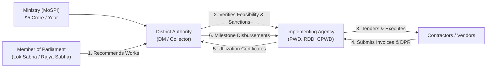
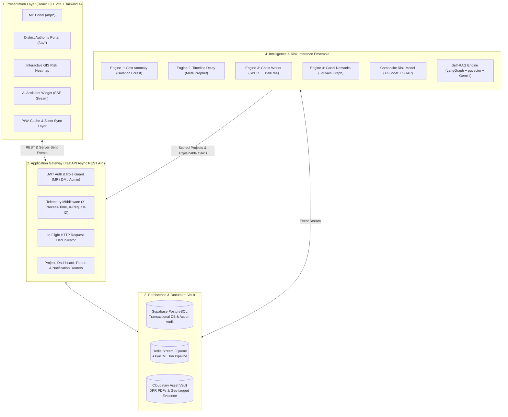
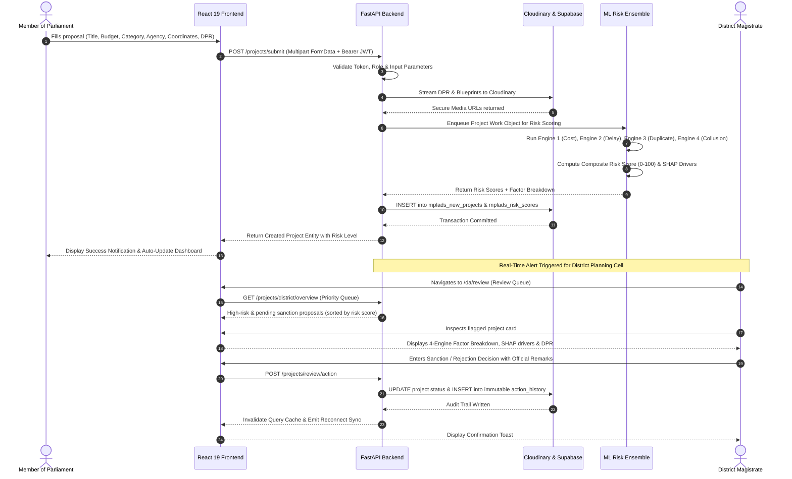
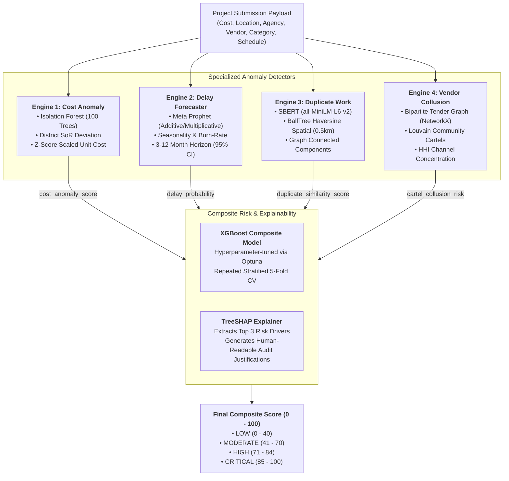
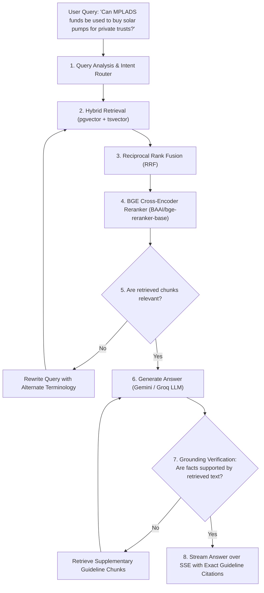
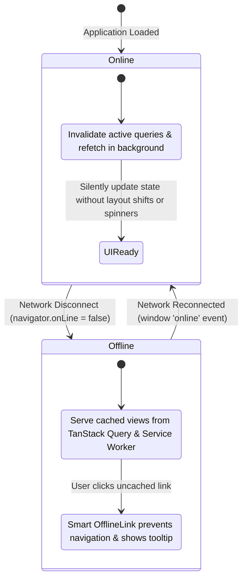

# 🏛️ MPLADS Risk Monitor

> **AI-Powered Surveillance, Anomaly Detection & Public Expenditure Intelligence for the Member of Parliament Local Area Development Scheme (MPLADS)**
> *Developed for the Smart India Hackathon (SIH 2026) under the Ministry of Statistics and Programme Implementation (MoSPI), Government of India.*

[](https://opensource.org/licenses/MIT)
[](https://react.dev/)
[](https://fastapi.tiangolo.com/)
[](https://python.org)
[](https://supabase.com)
[](https://xgboost.readthedocs.io/)
[](https://www.langchain.com/)
[](https://www.w3.org/WAI/standards-guidelines/wcag/)
[](https://web.dev/progressive-web-apps/)

---

## 📌 Executive Summary

Every year, the Government of India allocates **₹5 Crore in capital infrastructure funding** to each Member of Parliament (MP) under the **Member of Parliament Local Area Development Scheme (MPLADS)**—amounting to approximately **₹4,000 Crore annually** disbursed across 543 Lok Sabha and 245 Rajya Sabha constituencies.

Historically, tracking and auditing these decentralized funds across 700+ district administrations has been crippled by manual paper workflows, opaque sanctioning pipelines, and departmental information silos. These systemic bottlenecks lead to:
1. **Severe Fund Underutilization & Lapsing Balances** due to execution delays and sanction bottlenecks.
2. **Cost Padding & Inflation** against standard District Schedule of Rates (SoR).
3. **Duplicate & "Ghost" Works** sanctioned at identical geospatial coordinates under divergent budget heads.
4. **Contractor Cartels & Vendor Monopolies** capturing tenders across adjacent constituencies.
5. **Guideline Non-Compliance** due to the complexity of the 100+ page official MoSPI statutory manual.

**MPLADS Risk Monitor** transforms this opaque, paper-heavy bureaucratic pipeline into a transparent, data-driven, and AI-audited governance platform. It features specialized portals for **Members of Parliament** and **District Authorities (District Magistrates / Collectors)**, backed by an **asynchronous 4-engine Machine Learning risk ensemble**, a **Self-RAG statutory compliance assistant**, interactive **GIS risk mapping**, and a **fault-tolerant, offline-first progressive web architecture**.

---

## 📑 Table of Contents

- [🏛️ Understanding MPLADS: How the Scheme Works](#-understanding-mplads-how-the-scheme-works)
  - [The Four Operational Pillars](#the-four-operational-pillars)
  - [Systemic Vulnerabilities in Public Works](#systemic-vulnerabilities-in-public-works)
- [🔄 Project Lifecycle & Tri-Tier Workflow](#-project-lifecycle--tri-tier-workflow)
  - [End-to-End Governance Sequence](#end-to-end-governance-sequence)
  - [How Frontend, Backend, ML & RAG Collaborate](#how-frontend-backend-ml--rag-collaborate)
- [🧠 Machine Learning Risk & Anomaly Detection Pipeline](#-machine-learning-risk--anomaly-detection-pipeline)
  - [Engine 1: Cost Anomaly & Rate Inflation Detector](#engine-1-cost-anomaly--rate-inflation-detector)
  - [Engine 2: Timeline Delay & Fund Utilization Forecaster](#engine-2-timeline-delay--fund-utilization-forecaster)
  - [Engine 3: Geospatial & Semantic Duplicate Work Detector](#engine-3-geospatial--semantic-duplicate-work-detector)
  - [Engine 4: Vendor Collusion & Cartel Network Detector](#engine-4-vendor-collusion--cartel-network-detector)
  - [Composite Risk Scoring & SHAP Explainability](#composite-risk-scoring--shap-explainability)
- [🤖 Self-RAG Statutory Compliance Assistant](#-self-rag-statutory-compliance-assistant)
- [💻 Frontend Architecture & Portals](#-frontend-architecture--portals)
  - [Member of Parliament (MP) Portal](#member-of-parliament-mp-portal)
  - [District Authority (DA) Portal](#district-authority-da-portal)
  - [Offline-First Resilience & Silent Reconnect](#offline-first-resilience--silent-reconnect)
  - [Accessibility & UI Engineering (WCAG 2.1 AA)](#accessibility--ui-engineering-wcag-21-aa)
- [⚙️ Backend Services & Data Model](#️-backend-services--data-model)
  - [Entity Relationship Diagram](#entity-relationship-diagram)
  - [REST API Reference](#rest-api-reference)
- [📁 Repository Structure](#-repository-structure)
- [🚀 Quickstart & Local Setup](#-quickstart--local-setup)
- [🔍 SEO Optimization, Discoverability & Keywords](#-seo-optimization-discoverability--keywords)
- [🛡️ Verification, Testing & Code Quality](#️-verification-testing--code-quality)
- [📜 License & Acknowledgments](#-license--acknowledgments)

---

## 🏛️ Understanding MPLADS: How the Scheme Works

The **Member of Parliament Local Area Development Scheme (MPLADS)** is a Centrally Sponsored Plan Scheme formulated by the Government of India in December 1993, administered under the **Ministry of Statistics and Programme Implementation (MoSPI)**.



### The Four Operational Pillars

1. **Constituency Entitlement & Allocations**:
   - Each MP is entitled to recommend developmental works of up to **₹5 Crore per fiscal year**, released in two equal tranches of ₹2.5 Crore by MoSPI directly to the designated **Nodal District Authority**.
   - Lok Sabha MPs recommend works within their designated **Lok Sabha Parliamentary Constituency**.
   - Rajya Sabha MPs recommend works across their **elected State**.
   - Nominated MPs can recommend works **anywhere in India**.
   - Minimum statutory quotas require **15% for SC** inhabited areas and **7.5% for ST** inhabited areas.

2. **Role of the Member of Parliament (Recommending Body)**:
   - Identifies high-impact community needs: drinking water installations, primary healthcare centers, smart classrooms, crematoriums, flood protection embankments, and village approach roads.
   - Submits formal project recommendations with estimated expenditure to the District Collector.
   - *Constraint*: MPs cannot sanction funds or select executing contractors directly; they serve strictly as the recommending authority.

3. **Role of the District Authority (Sanctioning & Financial Gatekeeper)**:
   - Led by the District Magistrate (DM), District Collector, or Deputy Commissioner.
   - Scrutinizes proposal eligibility against the official MoSPI Negative List (e.g., prohibition of commercial, religious, or private assets).
   - Confirms administrative, technical, and financial feasibility.
   - Identifies and entrusts execution to a competent **Implementing Agency (IA)** (e.g., Public Works Department (PWD), Rural Development Department (RDD), CPWD, or Municipal Corporation).
   - Issues formal Administrative Sanction (AS) and Financial Sanction (FS).

4. **Execution, Monitoring & Fund Utilization**:
   - The Implementing Agency issues competitive tenders and awards execution contracts to qualified vendors.
   - Funds are disbursed in tranches conditional on physical verification milestones and submission of formal **Utilization Certificates (UCs)**.

---

### Systemic Vulnerabilities in Public Works

| Governance Challenge | Traditional Manual Vulnerability | How MPLADS Risk Monitor Solves It |
| :--- | :--- | :--- |
| **Budget Inflation** | Contractors quote 30%–80% above standard Schedule of Rates (SoR). | **Engine 1** flags unit cost deviations using Isolation Forest and local rate benchmarks. |
| **Idle & Lapsing Funds** | Proposals linger in district planning cells; unspent balances lapse. | **Engine 2** forecasts completion velocity with Meta Prophet and triggers pre-lapse warnings. |
| **Duplicate / Ghost Works** | Identical borewells or roads are sanctioned under MPLADS, MGNREGS, and State schemes. | **Engine 3** clusters text semantics (SBERT) and geo-coordinates (BallTree Haversine) to catch overlaps. |
| **Vendor Cartels & Collusion** | Shell entities and interconnected contractors rig tenders across districts. | **Engine 4** constructs bipartite tender networks and Louvain community graphs to detect rings. |
| **Regulatory Ambiguity** | Manual errors in verifying whether proposed assets violate MoSPI negative lists. | **Self-RAG Assistant** cites exact clause numbers and compliance guidelines in real time. |

---

## 🔄 Project Lifecycle & Tri-Tier Workflow

The system coordinates four distinct architectural layers to deliver frictionless governance, real-time risk evaluation, and transparency:



---

### End-to-End Governance Sequence

The following sequence tracks a development proposal from initial submission by an MP to AI risk assessment, DM review, sanctioning, and audit logging:



---

### How Frontend, Backend, ML & RAG Collaborate

1. **Proposal Inception (Frontend)**:
   The MP inputs project parameters in `MpSubmitProject.jsx`. Costs are automatically converted between standard INR, Lakhs, and Crores. Supporting Detailed Project Reports (DPRs) and blueprints are attached as PDFs.

2. **Secure Gateway & Ingestion (Backend)**:
   FastAPI verifies JWT claims via dependency injection (`get_current_mp`). It offloads file uploads asynchronously to Cloudinary, ensuring zero local file footprint, and initiates a transactional record in Supabase.

3. **Multi-Model Scoring (ML Ensemble)**:
   The backend routes the work payload through the ML pipeline. The four engines compute dimensional risk vectors (rate deviation, delay hazard, duplicate probability, cartel saturation). The XGBoost meta-learner generates a calibrated 0–100 score and SHAP explanation attributes.

4. **Intelligent Review & Sanction (Frontend & Backend)**:
   The District Magistrate logs in to the DA Portal (`/da/review`). Proposals are automatically triaged by risk severity. The DM inspects itemized explanations rather than arbitrary predictions (e.g., *"Cost is 42% higher than District SoR benchmarks; Contractor has 68% tender capture rate"*).

5. **Statutory Guideline Grounding (RAG Assistant)**:
   Whenever an MP or DM encounters an ambiguous situation (e.g., *"Can MPLADS funds be used to purchase medical ambulances for private trust hospitals?"*), the embedded AI Assistant (`AiAssistantWidget.jsx`) queries the Self-RAG service over Server-Sent Events (SSE), streaming answers grounded in official MoSPI gazette notifications.

---

## 🧠 Machine Learning Risk & Anomaly Detection Pipeline

Rather than relying on a black-box model, the platform deploys an **ensemble of four specialized domain-specific detectors** synthesized by an **XGBoost Composite Classifier with SHAP explainability**.



---

### Engine 1: Cost Anomaly & Rate Inflation Detector
* **Source Location**: `ML model/final_pipeline/src/cost_anomaly_detector.py`
* **Core Algorithm**: **Isolation Forest** (100 estimators, $contamination=0.05$) combined with **StandardScaler** feature transformation.
* **Feature Vector**:
  $$\vec{X}_{cost} = \left[ \text{unit\_cost}, \text{sor\_rate}, \text{expected\_cost}, \text{cost\_deviation\_pct} \right]$$
  where:
  $$\text{cost\_deviation\_pct} = \frac{\text{proposed\_unit\_cost} - \text{district\_sor\_rate}}{\text{district\_sor\_rate}} \times 100$$
* **Functionality**: Isolates projects whose budgeted cost per unit metric (e.g., ₹/meter for rural road pavement, ₹/seat for school auditorium) deviates significantly from the statistical distribution of sanctioned rates in that district.
* **Output**: Continuous anomaly score and binary flag isolating top padded proposals.

---

### Engine 2: Timeline Delay & Fund Utilization Forecaster
* **Source Location**: `ML model/final_pipeline/src/fund_utilization_forecaster.py`
* **Core Algorithm**: **Meta Prophet** (additive changepoint prior scale = 0.01) coupled with **ARIMA** seasonality estimation.
* **Input Data**: Monthly aggregated expenditure histories per MP, constituency, and work category.
* **Forecasting Dynamics**:
  $$y(t) = g(t) + s(t) + h(t) + \epsilon_t$$
  - $g(t)$: Piecewise linear non-periodic growth curve modeling the expenditure burn-rate.
  - $s(t)$: Periodic yearly seasonality capturing post-monsoon construction surges and fiscal year-end March spikes.
* **Output**: Generates a forward 3-month to 12-month expenditure forecast with a 95% confidence interval ($y_{lower}, y_{upper}$), isolating whether the remaining balance will lapse before the financial year closure.

---

### Engine 3: Geospatial & Semantic Duplicate Work Detector
* **Source Location**: `ML model/final_pipeline/src/duplicate_ghost_work_detector.py`
* **Core Algorithms**:
  1. **Spatial Proximity**: `sklearn.neighbors.BallTree` indexing earth coordinates with Haversine distance metric:
     $$d_{haversine} = 2 R \arcsin \left( \sqrt{\sin^2\left(\frac{\Delta \phi}{2}\right) + \cos \phi_1 \cos \phi_2 \sin^2\left(\frac{\Delta \lambda}{2}\right)} \right)$$
  2. **NLP Semantic Similarity**: **Sentence-BERT (`all-MiniLM-L6-v2`)** producing 384-dimensional dense embeddings evaluated via Cosine Similarity:
     $$S_{semantic} = \frac{\vec{u} \cdot \vec{v}}{\|\vec{u}\| \|\vec{v}\|}$$
  3. **Cluster Resolution**: `scipy.sparse.csgraph.connected_components` uniting pairwise matches into duplicate infrastructure clusters.
* **Tiered Proximity Thresholds**:
  - `Exact Match`: $\le 0.5\text{ km}$ ($w = 1.0$)
  - `Small Cluster`: $\le 1.0\text{ km}$ ($w = 0.85$)
  - `Shared Institutional Site`: $\le 5.0\text{ km}$ ($w = 0.45$)
* **Weighted Duplication Formula**:
  $$\text{Score}_{dup} = 0.55 \cdot S_{semantic} + 0.20 \cdot \Delta_{cost} + 0.10 \cdot \Delta_{date} + 0.15 \cdot S_{geo}$$
* **Threshold**: Proposals exceeding $0.65$ are flagged with conflicting historical project IDs and mapped coordinates.

---

### Engine 4: Vendor Collusion & Cartel Network Detector
* **Source Location**: `ML model/final_pipeline/src/vendor_collusion_network_detector.py`
* **Core Algorithms**: Bipartite Graph Projection & **Louvain Community Detection** via `NetworkX`.
* **Network Construction**:
  - Bipartite nodes: $\mathcal{V}_{vendors} \cup \mathcal{U}_{tenders/agencies}$.
  - Edge weights reflect contract values and co-bidding frequencies.
* **Risk Dimension Metrics**:
  - **Within-Community Concentration**: Fraction of awards won within a closed contractor ring.
  - **Thin Capitalization Ratio**:
    $$\text{Ratio}_{cap} = \frac{\text{Awarded Contract Volume}}{\text{Vendor Paid-Up Share Capital}}$$
  - **Market Capture Share (HHI)**: Herfindahl-Hirschman index isolating vendor monopoly within a specific District / Implementing Agency.
  - **Corporate Verification**: Cross-referencing Ministry of Corporate Affairs (MCA) active shell-company and debarment/blacklist registers.

---

### Composite Risk Scoring & SHAP Explainability
* **Source Location**: `ML model/final_pipeline/src/composite_risk_model.py`
* **Architecture**: Gradient-boosted decision trees (**XGBoost**) tuned using **Optuna** over 120 trials with 5-fold Repeated Stratified Cross-Validation.
* **Explainability with TreeSHAP**:
  Every prediction is decomposed into additive feature attributions:
  $$\hat{f}(x) = \phi_0 + \sum_{i=1}^{M} \phi_i(x)$$
  The three largest positive SHAP contributors ($\phi_i$) are formatted into natural-language explanation cards presented directly to the District Magistrate:
  > *"Risk: 86/100 (CRITICAL) — Top Factors: (1) Cost anomaly exceeds local SoR by +48.2%; (2) Vendor cartel probability is 0.78 with shared address history; (3) Predicted 9-month execution overrun."*

---

## 🤖 Self-RAG Statutory Compliance Assistant

* **Location**: `rag/backend/` & `frontend/src/components/shared/AiAssistantWidget.jsx`
* **Knowledge Base**: Complete official MoSPI MPLADS Guidelines (2016 Edition, 2023 Revised Guidelines, and Parliamentary Circulars).



### Self-RAG Highlights:
- **Hierarchical Parent-Child Chunking**: Retains section headers, circular numbers, and guideline tables intact.
- **Hybrid Retrieval**: Combines semantic dense retrieval (`pgvector` with `BAAI/bge-base-en-v1.5`) and lexical keyword search (PostgreSQL `tsvector`) using Reciprocal Rank Fusion (RRF).
- **Two-Tier LLM Architecture**: Primary synthesis powered by Google Gemini with automatic failover to Groq (Llama-3-70B) for 99.9% uptime.
- **Strict Hallucination Prevention**: Automated verification checks reject speculative answers and demand exact MoSPI paragraph references.

---

## 💻 Frontend Architecture & Portals

The frontend is a desktop-grade Single Page Application built on **React 19**, **Vite 8**, and **Tailwind CSS 4**. It features zero full-page layout shifts, sub-50ms transitions via persistent shell navigation, and complete offline survivability.

### Member of Parliament (MP) Portal
* **Dashboard (`/mp`)**: Real-time financial entitlement counters (₹5.00 Cr Entitlement, Amount Sanctioned, Amount Utilized, Unspent Balance), interactive expenditure trajectory charts, recent recommendations feed.
* **New Work Submission (`/mp/submit`)**: Multi-step proposal form with category validation, instant INR/Lakhs/Crore unit converter, coordinate picker, and Cloudinary PDF attachment uploader.
* **Portfolio Directory (`/mp/projects`)**: High-performance virtualized table (`@tanstack/react-virtual`) managing hundreds of constituency works with real-time text search, status filters, and risk badges.
* **Financial Reports (`/mp/reports`)**: Sector-wise expenditure breakdowns (Drinking Water, Sanitation, Education, Roads) rendered with Recharts.
* **Document Vault (`/mp/documents`)**: Centralized repository of Administrative Sanctions, Work Orders, and Utilization Certificates.

### District Authority (DA) Portal
* **District Dashboard (`/da`)**: High-level macro view of all MPs within the district jurisdiction, total funds under supervision, and emergency risk alerts.
* **Priority Review Queue (`/da/review`)**: Intelligent triage inbox prioritizing incoming proposals by composite risk score. Provides DMs with a one-click review card containing itemized detector insights, DPR attachments, and formal approval/rejection forms.
* **Interactive GIS Risk Map**: Leaflet choropleth map rendering constituency boundaries color-coded by risk intensity, allowing magistrates to inspect spatial clusters of delays or contractor saturation.
* **Vendor Watchlist (`/da/vendors`)**: Audits vendor concentration across public agencies, highlighting blacklisted contractors, thin capitalizations, or tender capture rates.
* **Implementing Agency Directory (`/da/agencies`)**: Tracks operational bandwidth, pending project backlog, and historical completion velocities across PWD, RDD, CPWD, etc.

---

### Offline-First Resilience & Silent Reconnect

Public officials often operate in rural areas with intermittent cellular connectivity. The platform implements an offline architecture:



- **Smart `OfflineLink` Navigation**: Any route that has not yet been cached in client memory is automatically disabled with an informative offline tooltip, preventing jarring 404 or broken page exceptions.
- **Silent Background Sync**: When the device regains internet access, the system refetches stale data in the background without triggering disruptive full-page spinners or layout flashes.
- **Client Request Deduplication**: Prevents request storms on server cold-starts by coalescing identical in-flight promises within a 3,000ms window.

---

### Accessibility & UI Engineering (WCAG 2.1 AA)

- **Official Indian Government Aesthetics**: Compliant with the Guidelines for Indian Government Websites (GIGW), incorporating the State Emblem of India, tricolor national accents, and standard typography (`Plus Jakarta Sans` & `Inter`).
- **Screen Reader Landmarks & Skip Links**: Includes `Skip to main content` bypass mechanisms and structured `<main>`, `<nav>`, `<aside>`, and `<header>` tags.
- **High-Contrast Color Semantics**: All text and interactive badges satisfy a minimum 4.5:1 contrast ratio against light and dark backgrounds.
- **Keyboard Navigation**: Complete keyboard operability across all custom modals, search filters, virtualized tables, and drawer menus.
- **Automated A11y Verification**: Continuously validated using `@axe-core/puppeteer` with **0 WCAG 2.1 AA violations**.

---

## ⚙️ Backend Services & Data Model

The backend is built with **FastAPI** on Python 3.11+, delivering asynchronous execution, automated OpenAPI/Swagger documentation, and Pydantic validation.

### Entity Relationship Diagram


---

### REST API Reference

| Endpoint | Method | Role | Description |
| :--- | :---: | :---: | :--- |
| `/user/login` | `POST` | Public | Authenticates user; issues 24-hour HS256 Bearer JWT. |
| `/user/mp/me` | `GET` | MP | Returns authenticated MP profile, constituency & state. |
| `/user/dm/me` | `GET` | DM | Returns District Magistrate administrative jurisdiction. |
| `/dashboard/details/mp` | `GET` | MP | Entitlement, utilization balances, and project risk counts. |
| `/dashboard/details/dm` | `GET` | DM | District-wide portfolio aggregates and high-risk alerts. |
| `/projects/all` | `GET` | MP | Paginated list of constituency works with search & filters. |
| `/projects/submit` | `POST` | MP | Multipart endpoint uploading DPR files & running ML scoring. |
| `/projects/{project_id}` | `GET` | Authenticated | Comprehensive project detail with 4-engine risk cards. |
| `/projects/district/overview` | `GET` | DM | District review queue sorted by risk score priority. |
| `/projects/review/action` | `POST` | DM | Sanctions or rejects a proposal with immutable audit logging. |
| `/api/chat/stream` | `POST` | Authenticated | SSE streaming endpoint querying the Self-RAG assistant. |

---

## 📁 Repository Structure

```
MPLAD-Risk-Monitor/
├── .agents/                    # Autonomous developer skills & LLM agent definitions
│   └── skills/                 # Skills for accessibility, animations, SEO, and web performance
├── backend/                    # Core FastAPI Application
│   ├── auth/                   # JWT creation, decoding, and role dependency injection
│   ├── config/                 # Pydantic environment settings and security configurations
│   ├── database/               # Supabase PostgreSQL connection & Redis client
│   ├── routers/                # REST API controllers (projects, dashboard, reports, users)
│   ├── schemas/                # Pydantic request/response data models
│   ├── services/               # Business logic, Cloudinary client, and event auditing
│   └── main.py                 # FastAPI application factory, middleware, and CORS
├── frontend/                   # React 19 Client SPA
│   ├── public/                 # Static assets, fonts, icons, llms.txt, and manifests
│   ├── src/
│   │   ├── api/                # HTTP clients, in-flight deduplication, and TanStack Query hooks
│   │   ├── components/
│   │   │   ├── map/            # Leaflet GIS constituency risk maps
│   │   │   └── shared/         # Accessible badges, loaders, offline banners, AI chatbot widget
│   │   ├── pages/
│   │   │   ├── da/             # District Authority portal pages (Review, Vendors, Agencies)
│   │   │   ├── mp/             # Member of Parliament portal pages (Submit, Projects, Reports)
│   │   │   └── LoginPage/      # Unified role-based authentication portal
│   │   ├── store/              # Zustand stores for auth tokens and client UI state
│   │   ├── App.jsx             # React Router DOM 7 nested layouts and route guards
│   │   └── main.jsx            # Application bootstrap with TanStack Query provider
│   ├── vite.config.js          # Vite 8 configuration with Tailwind 4 plugin
│   └── package.json            # Frontend dependencies and test scripts
├── ML model/                   # Machine Learning Microservice & Pipelines
│   ├── final_pipeline/
│   │   ├── models/             # Trained serialized models (.pkl): XGBoost, Isolation Forest, Prophet
│   │   └── src/
│   │       ├── cost_anomaly_detector.py             # Engine 1: Isolation Forest
│   │       ├── fund_utilization_forecaster.py       # Engine 2: Meta Prophet
│   │       ├── duplicate_ghost_work_detector.py     # Engine 3: SBERT + BallTree
│   │       ├── vendor_collusion_network_detector.py # Engine 4: NetworkX Louvain Graph
│   │       ├── composite_risk_model.py              # XGBoost & TreeSHAP Meta-Learner
│   │       └── run_pipeline.py                      # Pipeline executor
│   ├── routes/                 # FastAPI routes for ML inference microservice
│   └── main.py                 # Standalone ML microservice entry point (Port 8001)
├── rag/                        # Self-RAG Knowledge System
│   ├── backend/                # LangGraph workflow, hybrid search, and LLM integrations
│   ├── data/                   # MoSPI guideline manuals, gazettes, and circulars
│   └── README.md               # Dedicated RAG setup and architecture guide
├── data/                       # Datasets, Schedule of Rates, and constituency shapefiles
└── preparation/                # Hackathon architectural guides, Q&A, and technical briefs
```

---

## 🚀 Quickstart & Local Setup

### Prerequisites
- **Node.js**: v18.0.0 or higher (`v20+` recommended)
- **Python**: v3.10 or higher (`v3.11` recommended)
- **PostgreSQL**: PostgreSQL 16 with `pgvector` extension (or cloud Supabase account)
- **Redis**: v7.0 or higher (for async job queues, or Upstash Redis)

---

### 1. Clone the Repository
```bash
git clone https://github.com/your-username/MPLAD-Risk-Monitor.git
cd MPLAD-Risk-Monitor
```

---

### 2. Configure Backend Service
```bash
cd backend
python -m venv .venv

# On Windows:
.venv\Scripts\Activate.ps1
# On Linux/macOS:
# source .venv/bin/activate

pip install -r requirements.txt
```

Create `.env` inside `backend/`:
```env
SUPABASE_URL=https://your-project.supabase.co
SUPABASE_KEY=your-supabase-service-role-key
JWT_SECRET=your-secure-random-jwt-secret-string
CLOUDINARY_CLOUD_NAME=your-cloud-name
CLOUDINARY_API_KEY=your-cloudinary-key
CLOUDINARY_API_SECRET=your-cloudinary-secret
REDIS_URL=redis://localhost:6379/0
```

Start the FastAPI Backend:
```bash
uvicorn main:app --reload --port 8000
```
*API Swagger Documentation will be accessible at `http://localhost:8000/docs`.*

---

### 3. Configure Frontend Application
Open a new terminal session:
```bash
cd frontend
npm install
```

Create `.env` inside `frontend/`:
```env
VITE_API_URL=http://localhost:8000
VITE_RAG_API_URL=http://localhost:8002
```

Launch the Vite Dev Server:
```bash
npm run dev
```
*The web portal will open at `http://localhost:5173`.*

---

### 4. Run the Machine Learning Microservice (Optional for Standalone Inference)
Open a new terminal session:
```bash
cd "ML model"
python -m venv .venv
.venv\Scripts\Activate.ps1
pip install -r requirements.txt
python main.py
```
*The ML inference API will run at `http://localhost:8001/docs`.*

---

### 5. Launch the Self-RAG Chatbot Service
Refer to the dedicated guide in [`rag/README.md`](rag/README.md) to initialize the pgvector database and start the LangGraph statutory reasoning service.

---

## 🔍 SEO Optimization, Discoverability & Keywords

To maximize visibility across government technology hubs, academic research citations, open-source repositories, and search engine crawlers, the project embeds modern SEO and metadata engineering:

### High-Intent Search Keyword Taxonomy

```
GovTech & Public Administration:
MPLADS, MoSPI, Member of Parliament Local Area Development Scheme, Government of India,
Public Capital Expenditure Monitoring, District Magistrate Review Queue, Constituency Fund Tracking,
Transparency in Governance, Smart India Hackathon 2026, SIH 2026 Winner, Digital India GovTech.

AI, Machine Learning & Fraud Auditing:
Public Works Fraud Detection, Cost Anomaly Detection, Schedule of Rates SoR Auditing,
Isolation Forest Public Finance, Vendor Collusion Network, Tender Cartel Detection,
Louvain Community Bipartite Graphs, Meta Prophet Fund Forecasting, Ghost Work Detection,
Sentence-BERT Geospatial Clustering, BallTree Haversine Proximity, Explainable AI GovTech,
TreeSHAP Feature Attribution, Machine Learning in Public Procurement.

Modern Software Architecture:
React 19 SPA, Tailwind CSS 4, FastAPI Asynchronous Backend, Supabase PostgreSQL,
Self-RAG LangGraph, BGE Reranker, Hybrid Search pgvector, Offline-First PWA,
TanStack Query Offline Cache, WCAG 2.1 AA Compliant Government Portal, Leaflet GIS Risk Heatmap.
```

### Structured Data & Machine Discovery
- **`llms.txt` Standard**: The application hosts a curated [`/llms.txt`](frontend/public/llms.txt) and `llms-full.txt` spec at its root for ingestion by autonomous AI coding agents and WebMCP systems.
- **Canonical Meta & OpenGraph**: Configured in `frontend/index.html` with preview cards for Twitter and LinkedIn social sharing.
- **Microdata & JSON-LD**: Schemas modeling `GovernmentService` and `SoftwareApplication` declaring the Ministry of Statistics and Programme Implementation as the governing entity.

---

## 🛡️ Verification, Testing & Code Quality

The codebase enforces strict code quality and reliability benchmarks across every pull request:

```bash
# Frontend Unit & Component Tests (27 passing tests)
cd frontend
npm test

# Production Build Verification (Zero bundling warnings)
npm run build

# High-Speed Rust Static Analysis (Oxlint)
npm run lint

# Automated Accessibility Verification (WCAG 2.1 AA - 0 violations)
npm run lint:a11y

# Backend Tests
cd ../backend
pytest
```

---

## 📜 License & Acknowledgments

- **License**: Released under the [MIT License](LICENSE).
- **Inspiration & Guidelines**: Formulated according to the statutory frameworks of the **Ministry of Statistics and Programme Implementation (MoSPI)**, Government of India.
- **Hackathon Platform**: Engineered for the **Smart India Hackathon (SIH 2026)** to deliver radical transparency and fiscal accountability to Indian public infrastructure.

---

<p align="center">
  <b>MPLADS Risk Monitor</b> • <i>Transparent Governance for All</i><br/>
  Empowering Members of Parliament and District Collectors through Artificial Intelligence.
</p>

