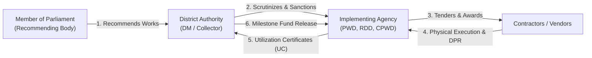
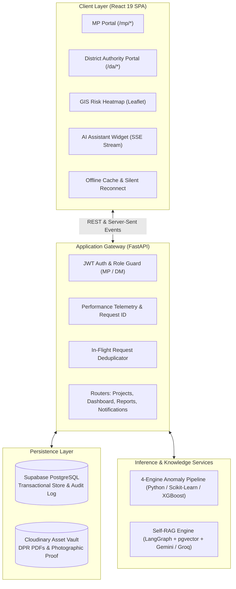
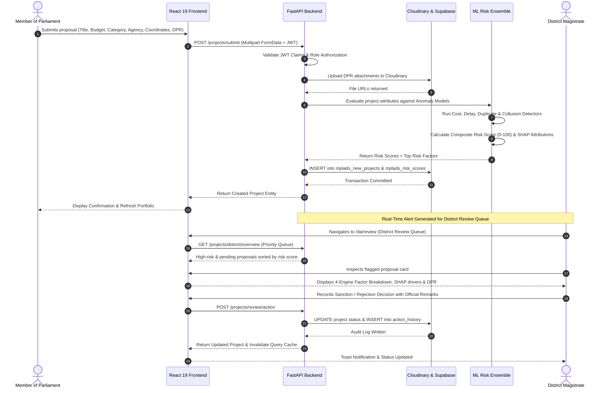
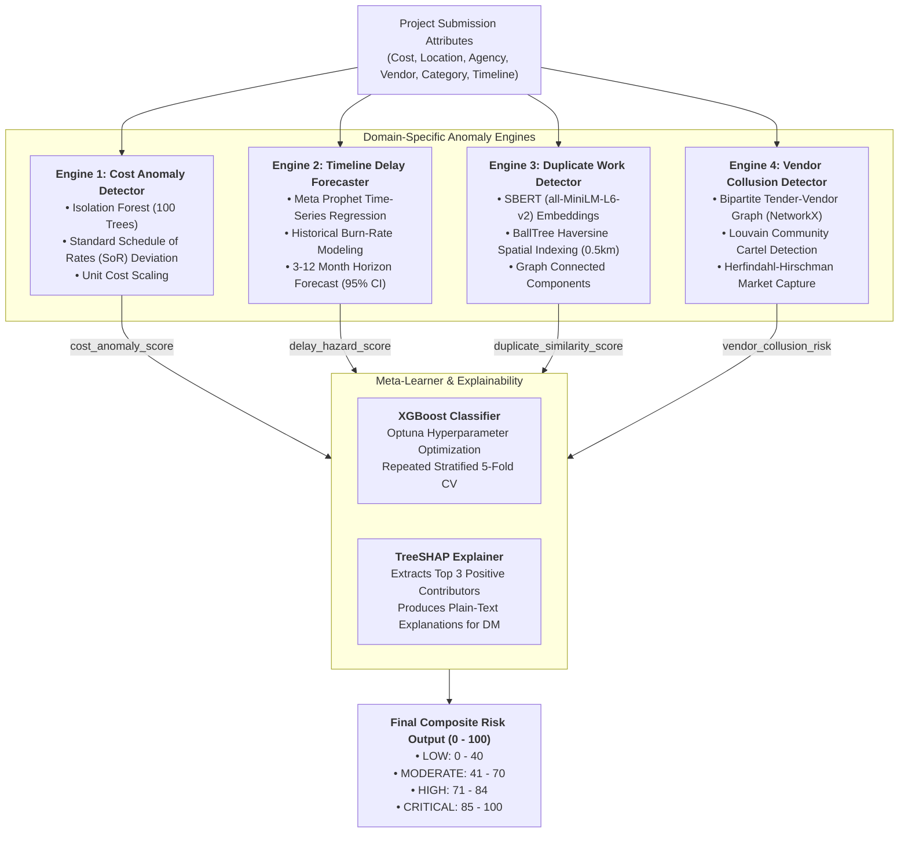
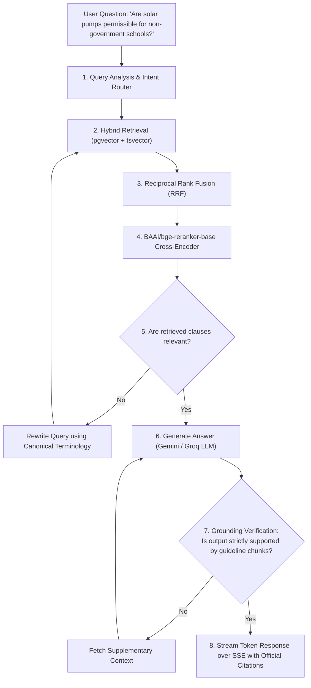
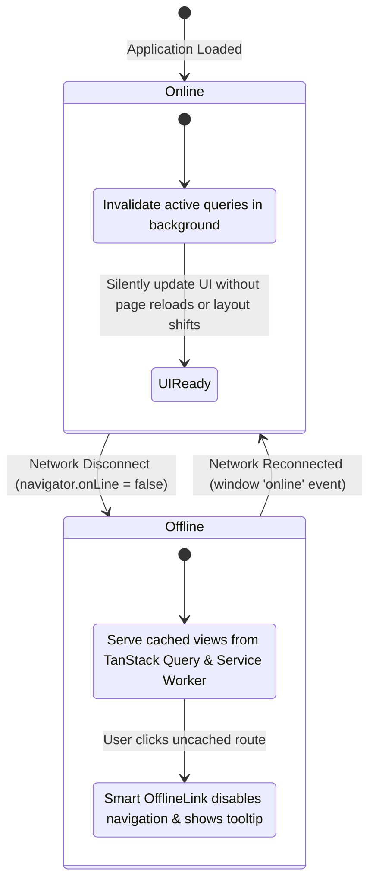
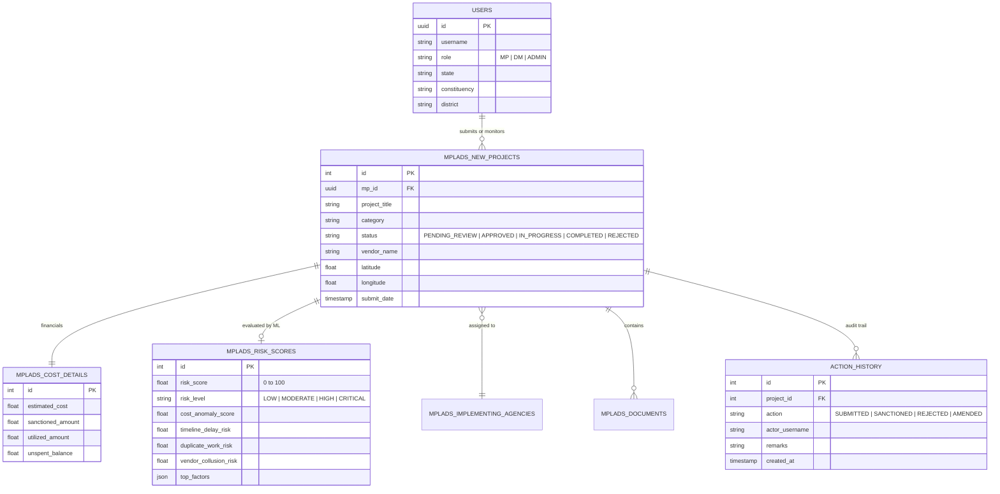

# MPLADS Risk Monitor

> An AI-driven surveillance, fraud detection, and public expenditure auditing platform designed for the **Member of Parliament Local Area Development Scheme (MPLADS)** under the Ministry of Statistics and Programme Implementation (MoSPI), Government of India.
> 
> *Developed as an engineering prototype for the Smart India Hackathon (SIH 2026).*

[](https://opensource.org/licenses/MIT)
[](https://react.dev/)
[](https://fastapi.tiangolo.com/)
[](https://python.org)
[](https://supabase.com)
[](https://xgboost.readthedocs.io/)
[](https://www.w3.org/WAI/standards-guidelines/wcag/)
[](https://github.com/)

---

## Table of Contents

1. [Executive Summary](#1-executive-summary)
2. [Understanding MPLADS: Domain & Governance Context](#2-understanding-mplads-domain--governance-context)
   - [Scheme Overview & Statutory Rules](#scheme-overview--statutory-rules)
   - [Administrative Roles & Lifecycle](#administrative-roles--lifecycle)
   - [Systemic Risk Vectors in Public Works](#systemic-risk-vectors-in-public-works)
3. [System Architecture & Workflow Integration](#3-system-architecture--workflow-integration)
   - [Component Collaboration Model](#component-collaboration-model)
   - [End-to-End Proposal Lifecycle Sequence](#end-to-end-proposal-lifecycle-sequence)
4. [Machine Learning Anomaly Detection Ensemble](#4-machine-learning-anomaly-detection-ensemble)
   - [Engine 1: Cost Anomaly & Rate Inflation Detector](#engine-1-cost-anomaly--rate-inflation-detector)
   - [Engine 2: Timeline Delay & Fund Lapse Forecaster](#engine-2-timeline-delay--fund-lapse-forecaster)
   - [Engine 3: Duplicate & Ghost Work Detector](#engine-3-duplicate--ghost-work-detector)
   - [Engine 4: Vendor Collusion & Cartel Network Detector](#engine-4-vendor-collusion--cartel-network-detector)
   - [Composite Risk Meta-Model & SHAP Explainability](#composite-risk-meta-model--shap-explainability)
5. [Self-RAG Statutory Compliance Assistant](#5-self-rag-statutory-compliance-assistant)
6. [Frontend Engineering & Portals](#6-frontend-engineering--portals)
   - [Member of Parliament (MP) Portal](#member-of-parliament-mp-portal)
   - [District Authority (DA) Portal](#district-authority-da-portal)
   - [Offline-First Resilience & Silent Reconnect](#offline-first-resilience--silent-reconnect)
   - [Accessibility (WCAG 2.1 AA)](#accessibility-wcag-21-aa)
7. [Backend Architecture & Data Schema](#7-backend-architecture--data-schema)
   - [Entity Relationship Diagram](#entity-relationship-diagram)
   - [Core REST Endpoints](#core-rest-endpoints)
8. [Tracked Repository Structure](#8-tracked-repository-structure)
9. [Local Development & Environment Setup](#9-local-development--environment-setup)
10. [Verification, Testing & Code Quality](#10-verification-testing--code-quality)
11. [Planned Enhancements & Roadmap](#11-planned-enhancements--roadmap)
12. [Search Taxonomy & SEO Metadata](#12-search-taxonomy--seo-metadata)
13. [License & Disclaimers](#13-license--disclaimers)

---

## 1. Executive Summary

Under the **Member of Parliament Local Area Development Scheme (MPLADS)**, each Member of Parliament (MP) is allocated **₹5 Crore annually** by the Central Government to recommend capital works of developmental nature in their constituencies. Across 543 Lok Sabha and 245 Rajya Sabha MPs, this represents an annual outlay of nearly **₹4,000 Crore**.

Managing these funds across 700+ district administrations has historically encountered systemic bottlenecks: paper-heavy application tracking, fund underutilization leading to lapse risks, non-standard rate estimates, duplicate sanctions under different scheme heads, and tender monopolization by local contractor rings.

**MPLADS Risk Monitor** provides a unified digital governance platform connecting Members of Parliament, District Magistrates, and citizen observers:
- **For MPs**: Real-time entitlement and expenditure balance monitoring, digital proposal submission with automated rate validation, and early notifications on unspent funds.
- **For District Authorities (DMs/Collectors)**: An automated review queue triaged by a 4-engine machine learning risk score, itemized anomaly explanations, vendor concentration tracking, and district-wide GIS risk maps.
- **For Compliance**: An integrated **Self-RAG** assistant citing official MoSPI guidelines in real time.

---

## 2. Understanding MPLADS: Domain & Governance Context

### Scheme Overview & Statutory Rules
The MPLAD Scheme was instituted in December 1993 and is administered by the **Ministry of Statistics and Programme Implementation (MoSPI)**.

- **Entitlement**: ₹5 Crore per annum allocated in two equal installments of ₹2.5 Crore to the designated Nodal District Authority.
- **Jurisdiction of Recommendations**:
  - **Lok Sabha MPs**: Recommend works strictly within their elected Parliamentary Constituency.
  - **Rajya Sabha MPs**: Recommend works within their elected State across one or more districts.
  - **Nominated MPs**: Can recommend eligible works in any State or Union Territory across India.
- **Statutory Quotas**: Under official MoSPI guidelines, MPs must allocate at least **15%** of their annual entitlement for areas inhabited by Scheduled Caste (SC) populations and **7.5%** for Scheduled Tribe (ST) populations.

### Administrative Roles & Lifecycle



1. **Recommending Authority (MP)**: Recommends durable community assets (e.g., drinking water installations, primary health centers, rural roads, smart classrooms). *Note: MPs cannot sanction funds or appoint contractors directly.*
2. **Sanctioning & Administrative Authority (District Collector/DM)**: Verifies work eligibility against the MoSPI negative list, assesses technical and financial estimates, sanctions funds, and designates an Implementing Agency.
3. **Execution Body (Implementing Agency)**: Public bodies (e.g., PWD, Rural Development Department, CPWD) that float tenders, award contracts, and oversee construction.
4. **Disbursement & Accounting**: Funds are released by the District Authority in tranches conditional on physical verification and formal **Utilization Certificates (UCs)**.

### Systemic Risk Vectors in Public Works

| Governance Challenge | Operational Reality | Platform Mitigation |
| :--- | :--- | :--- |
| **Cost Padding & Inflation** | Estimates quoted 30%–70% higher than local Schedule of Rates (SoR). | **Engine 1** computes unit cost deviations via Isolation Forest and regional benchmarks. |
| **Execution Delay & Fund Lapsing** | Proposals linger in planning cells; unspent funds risk surrender at fiscal year-end. | **Engine 2** forecasts expenditure velocity using Meta Prophet and triggers early-warning alerts. |
| **Duplicate / Ghost Infrastructure** | Similar works funded simultaneously across MPLADS, State schemes, and CSR at identical sites. | **Engine 3** detects text semantic overlap (SBERT) and geospatial proximity (BallTree Haversine). |
| **Vendor Collusion & Cartels** | Contractor rings using shell companies and shared addresses to capture tenders. | **Engine 4** maps bipartite vendor-agency networks and isolates communities with Louvain graphs. |
| **Statutory Non-Compliance** | Inadvertent approval of non-permissible works (e.g., commercial or private assets). | **Self-RAG Assistant** verifies proposal compliance against MoSPI guidelines in real time. |

---

## 3. System Architecture & Workflow Integration

The application follows a decoupled client-server architecture separating presentation, API routing, data persistence, and intelligence services:



### Component Collaboration Model
- **Frontend (React 19, Vite, Tailwind CSS 4)**: Renders persistent shell layouts (`MpLayout`, `DaLayout`), manages server-state caching with TanStack Query, and provides resilient offline navigation via `OfflineLink`.
- **Backend (FastAPI, Python 3.11)**: Validates incoming payloads with Pydantic, manages role-based access control, generates audit history, and handles file attachments via Cloudinary.
- **Persistence (Supabase PostgreSQL)**: Enforces relational integrity across users, projects, cost items, implementing agencies, and action audit histories.
- **Machine Learning Suite**: Evaluates incoming projects across four independent fraud and risk engines, producing normalized scores and SHAP explainability summaries.
- **RAG Knowledge Assistant**: Ingests MoSPI gazette notifications and guideline manuals into a vector store to answer statutory queries with exact clause citations.

---

### End-to-End Proposal Lifecycle Sequence



---

## 4. Machine Learning Anomaly Detection Ensemble

The ML suite is designed to avoid black-box obscurity. It deploys four specialized detection engines whose dimensional outputs are aggregated by a calibrated **XGBoost** meta-model with **TreeSHAP** attributions.



---

### Engine 1: Cost Anomaly & Rate Inflation Detector
- **Source**: `ML model/final_pipeline/src/cost_anomaly_detector.py`
- **Algorithm**: **Isolation Forest** ($100$ estimators, contamination factor $= 0.05$) combined with **StandardScaler** normalization.
- **Feature Vector**:
  $$\vec{X}_{cost} = \left[ \text{unit\_cost}, \text{sor\_rate}, \text{expected\_cost}, \text{cost\_deviation\_pct} \right]$$
  where:
  $$\text{cost\_deviation\_pct} = \frac{\text{proposed\_unit\_cost} - \text{district\_sor\_rate}}{\text{district\_sor\_rate}} \times 100$$
- **Function**: Detects projects whose budgeted cost per physical unit (e.g., ₹/meter of road, ₹/unit of water infrastructure) deviates significantly from the statistical baseline of approved works in that district.

---

### Engine 2: Timeline Delay & Fund Lapse Forecaster
- **Source**: `ML model/final_pipeline/src/fund_utilization_forecaster.py`
- **Algorithm**: **Meta Prophet** piecewise linear trend decomposition with **ARIMA** residual validation.
- **Model Formulation**:
  $$y(t) = g(t) + s(t) + \epsilon_t$$
  - $g(t)$: Non-periodic piecewise linear growth representing cumulative fund drawdown.
  - $s(t)$: Yearly seasonal terms accounting for monsoon construction halts and fiscal year-end March surges.
- **Output**: Projects monthly expenditure over a 3-month to 12-month forward horizon with a 95% confidence interval ($y_{lower}, y_{upper}$) to flag proposals at risk of stalling before fund surrender deadlines.

---

### Engine 3: Duplicate & Ghost Work Detector
- **Source**: `ML model/final_pipeline/src/duplicate_ghost_work_detector.py`
- **Algorithm**: Hybrid pipeline combining NLP semantic matching and spatial radius queries:
  1. **Geospatial Proximity**: `sklearn.neighbors.BallTree` indexing latitude/longitude using the Haversine metric ($R = 6,371.0088\text{ km}$).
  2. **Semantic Similarity**: **Sentence-BERT (`all-MiniLM-L6-v2`)** producing 384-dimensional dense vectors evaluated via Cosine Similarity.
  3. **Cluster Resolution**: `scipy.sparse.csgraph.connected_components` resolving pairwise matches into unified duplicate clusters.
- **Tiered Radius Precision**:
  - `Exact Match`: $\le 0.5\text{ km}$ ($w = 1.0$)
  - `Small Cluster`: $\le 1.0\text{ km}$ ($w = 0.85$)
  - `Shared Institutional Site`: $\le 5.0\text{ km}$ ($w = 0.45$)
- **Weighted Duplicate Metric**:
  $$\text{Score}_{dup} = 0.55 \cdot S_{semantic} + 0.20 \cdot \Delta_{cost} + 0.10 \cdot \Delta_{date} + 0.15 \cdot S_{geo}$$

---

### Engine 4: Vendor Collusion & Cartel Network Detector
- **Source**: `ML model/final_pipeline/src/vendor_collusion_network_detector.py`
- **Algorithm**: Bipartite graph modeling and **Louvain Community Detection** via `NetworkX`.
- **Dimensions Evaluated**:
  - **Within-Community Edge Concentration**: Frequency with which a subset of vendors repeatedly co-bid or win contracts within specific administrative blocks.
  - **Thin Capitalization Ratio**: Ratio of cumulative awarded contract volume to reported paid-up share capital.
  - **Market Capture (HHI)**: Herfindahl-Hirschman Index quantifying vendor monopoly within a specific District or Implementing Agency.

---

### Composite Risk Meta-Model & SHAP Explainability
- **Source**: `ML model/final_pipeline/src/composite_risk_model.py`
- **Architecture**: **XGBoost Classifier** optimized via **Optuna** across 120 trials with 5-fold Repeated Stratified Cross-Validation.
- **Human-Readable Explanations (TreeSHAP)**:
  Decomposes model predictions into additive feature contributions ($\phi_i$):
  $$\hat{f}(x) = \phi_0 + \sum_{i=1}^{M} \phi_i(x)$$
  The three largest positive contributors are formatted into plain-text summaries presented on the District Magistrate's review dashboard (e.g., *"Unit cost is +42% above District SoR; Vendor has 65% market capture in block; Predicted 8-month completion delay"*).

---

## 5. Self-RAG Statutory Compliance Assistant

- **Source**: `rag/backend/` and `frontend/src/components/shared/AiAssistantWidget.jsx`
- **Knowledge Corpus**: Official MoSPI MPLADS Guidelines (2016 Edition, 2023 Revised Guidelines, and relevant Circulars).



- **Chunking**: Hierarchical parent-child chunking preserving chapter headings, circular reference codes, and guideline tables.
- **Hybrid Retrieval**: Combines semantic vector similarity (`BAAI/bge-base-en-v1.5` with `pgvector`) and keyword search (`tsvector`) via Reciprocal Rank Fusion.
- **Anti-Hallucination Verification**: LangGraph workflow executes verification loops requiring cited paragraph numbers before streaming responses to the client.

---

## 6. Frontend Engineering & Portals

The frontend is built using **React 19**, **Vite 8**, and **Tailwind CSS 4**, delivering a responsive, desktop-grade interface with zero layout shifts.

### Member of Parliament (MP) Portal
- **Dashboard (`/mp`)**: Displays entitlement counters (₹5.00 Cr Entitlement, Sanctioned, Utilized, Balance), monthly expenditure velocity charts, and recent recommendations.
- **Proposal Submission (`/mp/submit`)**: Multi-step recommendation form with category validation, instant INR/Lakhs/Crores unit converter, and Cloudinary PDF attachment uploader.
- **Projects Directory (`/mp/projects`)**: Virtualized table (`@tanstack/react-virtual`) managing constituency works with real-time text search, status filters, and risk badges.
- **Financial Analytics (`/mp/reports`)**: Sector-wise expenditure breakdowns (Drinking Water, Sanitation, Education, Roads) rendered using Recharts.
- **Document Vault (`/mp/documents`)**: Repository of Administrative Sanctions, Work Orders, and Utilization Certificates.

### District Authority (DA) Portal
- **District Command Dashboard (`/da`)**: Macro view of all constituencies within the district, monitored MPs, and risk alerts.
- **Priority Review Queue (`/da/review`)**: Inbox triaging incoming proposals by composite risk score. Provides DMs with a one-click review card containing itemized detector insights, DPR attachments, and sanction/rejection action modals.
- **Interactive GIS Risk Map**: Leaflet choropleth map rendering constituency boundaries color-coded by risk intensity.
- **Vendor Watchlist (`/da/vendors`)**: Audits vendor concentration across public agencies, highlighting blacklisted contractors or thin capitalizations.
- **Implementing Agency Directory (`/da/agencies`)**: Tracks project backlog and completion velocity across PWD, RDD, CPWD, etc.

---

### Offline-First Resilience & Silent Reconnect

To support public officials operating in areas with intermittent connectivity, the frontend incorporates an offline-first state machine:



- **Smart `OfflineLink`**: Routes not yet cached in memory or service worker are disabled with an informative tooltip, preventing 404 or white-screen errors.
- **Silent Background Sync**: When connectivity returns, TanStack Query invalidates stale queries and updates data silently without layout shifts or intrusive spinners.
- **In-Flight Request Deduplication**: Coalesces concurrent calls to identical endpoints into a single promise within a 3,000ms window, protecting against API waterfalls during backend cold-starts.

---

### Accessibility (WCAG 2.1 AA)
- **Visual Design**: Compliant with Guidelines for Indian Government Websites (GIGW), incorporating the State Emblem of India and standard typography (`Plus Jakarta Sans`, `Inter`).
- **Keyboard Navigation**: Complete keyboard operability across custom modals, search filters, and virtualized tables.
- **High-Contrast Semantics**: All text and risk status badges maintain a minimum 4.5:1 contrast ratio.
- **Automated Verification**: Continuously validated with `@axe-core/puppeteer` with **0 WCAG 2.1 AA violations**.

---

## 7. Backend Architecture & Data Schema

The backend is built with **FastAPI** on Python 3.11+, providing asynchronous execution, automated OpenAPI documentation, and Pydantic validation.

### Entity Relationship Diagram



---

### Core REST Endpoints

| Endpoint | Method | Role | Description |
| :--- | :---: | :---: | :--- |
| `/user/login` | `POST` | Public | Authenticates credentials; issues 24-hour HS256 Bearer JWT. |
| `/user/mp/me` | `GET` | MP | Returns authenticated MP profile, constituency, and state. |
| `/user/dm/me` | `GET` | DM | Returns District Magistrate administrative jurisdiction. |
| `/dashboard/details/mp` | `GET` | MP | Entitlement, utilization balances, and project risk counts. |
| `/dashboard/details/dm` | `GET` | DM | District-wide portfolio aggregates and high-risk alerts. |
| `/projects/all` | `GET` | MP | Paginated list of constituency works with search & filters. |
| `/projects/submit` | `POST` | MP | Multipart endpoint uploading DPR files & running ML scoring. |
| `/projects/{project_id}` | `GET` | Auth | Full project detail with itemized 4-engine risk cards. |
| `/projects/district/overview` | `GET` | DM | District review queue sorted by risk score priority. |
| `/projects/review/action` | `POST` | DM | Sanctions or rejects a proposal with immutable audit logging. |
| `/api/chat/stream` | `POST` | Auth | SSE streaming endpoint querying the Self-RAG assistant. |

---

## 8. Tracked Repository Structure

The following tree represents the clean, tracked source repository (all generated caches, virtual environments, binaries, and local environment files are ignored via `.gitignore`):

```
MPLAD-Risk-Monitor/
├── backend/
│   ├── auth/                       # JWT encoding, decoding, and role dependencies
│   ├── config/                     # Environment configuration and app settings
│   ├── database/                   # Supabase PostgreSQL client and Redis connection
│   ├── routers/                    # REST API route controllers
│   │   ├── dashboard_router.py     # Aggregated MP and DA dashboard metrics
│   │   ├── document_router.py      # Document upload and retrieval routes
│   │   ├── notification_router.py  # User notifications and alerts
│   │   ├── projects_route.py       # Project submission, review, and listing
│   │   ├── report_route.py         # Financial and annual report generation
│   │   └── user_router.py          # Authentication and user profiles
│   ├── schemas/                    # Pydantic request and response schemas
│   ├── services/                   # Business logic, Cloudinary, and audit services
│   ├── main.py                     # FastAPI application factory and middleware
│   ├── pyproject.toml              # Python project metadata
│   └── requirements.txt            # Python dependencies
├── frontend/
│   ├── public/                     # Static assets, fonts, icons, and manifests
│   ├── src/
│   │   ├── api/                    # HTTP clients, in-flight deduplication, and React Query hooks
│   │   ├── components/             # Reusable UI components
│   │   │   ├── map/                # Leaflet GIS constituency risk maps
│   │   │   └── shared/             # Accessible badges, loaders, offline banners, AI chatbot widget
│   │   ├── hooks/                  # Custom React hooks (SEO, network status, dialog a11y)
│   │   ├── pages/                  # Portal page views
│   │   │   ├── da/                 # District Authority views (Review, Vendors, Agencies)
│   │   │   ├── mp/                 # Member of Parliament views (Submit, Projects, Reports)
│   │   │   └── LoginPage/          # Unified role-based authentication portal
│   │   ├── store/                  # Zustand stores for auth and client state
│   │   ├── App.jsx                 # Nested persistent layouts and route configuration
│   │   └── main.jsx                # Application bootstrap with TanStack Query provider
│   ├── package.json                # Node dependencies and scripts
│   └── vite.config.js              # Vite 8 build configuration with Tailwind 4
├── ML model/
│   ├── final_pipeline/
│   │   └── src/                    # Core machine learning anomaly detection engines
│   │       ├── cost_anomaly_detector.py             # Engine 1: Isolation Forest
│   │       ├── fund_utilization_forecaster.py       # Engine 2: Meta Prophet
│   │       ├── duplicate_ghost_work_detector.py     # Engine 3: SBERT + BallTree
│   │       ├── vendor_collusion_network_detector.py # Engine 4: Louvain Cartel Graph
│   │       ├── composite_risk_model.py              # XGBoost & TreeSHAP Meta-Learner
│   │       └── run_pipeline.py                      # Pipeline orchestration logic
│   ├── routes/                     # FastAPI inference microservice routes
│   ├── main.py                     # Standalone ML microservice entry point
│   └── requirements.txt            # ML dependencies
└── rag/
    ├── backend/                    # LangGraph workflow, hybrid search, and embeddings
    ├── data/                       # Official MoSPI guideline documents
    ├── docker-compose.yml          # Container configuration for local pgvector
    └── README.md                   # Dedicated RAG setup and architecture guide
```

---

## 9. Local Development & Environment Setup

### Prerequisites
- **Node.js**: v18.0.0 or higher (`v20+` recommended)
- **Python**: v3.11 or higher
- **PostgreSQL**: PostgreSQL 16 with `pgvector` extension (or a Supabase instance)

---

### Step 1: Configure & Start Backend
Navigate to `backend/` and initialize a virtual environment:

```bash
cd backend
python -m venv .venv

# On Windows:
.venv\Scripts\Activate.ps1
# On Linux/macOS:
# source .venv/bin/activate

pip install -r requirements.txt
```

Create a local `.env` file inside `backend/` using the template below:

```env
# Database & Authentication
SUPABASE_URL=https://<your-supabase-project-id>.supabase.co
SUPABASE_KEY=your-supabase-service-role-or-anon-key
JWT_SECRET=your-secure-random-jwt-secret-string

# Cloudinary Evidence Storage
CLOUDINARY_CLOUD_NAME=your-cloudinary-cloud-name
CLOUDINARY_API_KEY=your-cloudinary-api-key
CLOUDINARY_API_SECRET=your-cloudinary-api-secret

# Redis (Optional: for asynchronous task streams)
REDIS_URL=redis://localhost:6379/0
```

> 🔒 **Security Notice**: Never commit `.env` or production credentials to version control. All configuration files containing secrets are ignored via `.gitignore`.

Start the FastAPI application:
```bash
uvicorn main:app --reload --port 8000
```
*API documentation will be available at `http://localhost:8000/docs`.*

---

### Step 2: Configure & Start Frontend
In a new terminal, navigate to `frontend/`:

```bash
cd frontend
npm install
```

Create a local `.env` file inside `frontend/`:

```env
VITE_API_URL=http://localhost:8000
VITE_RAG_API_URL=http://localhost:8002
```

Start the Vite development server:
```bash
npm run dev
```
*The web portal will open at `http://localhost:5173`.*

---

### Step 3: Run the Machine Learning Microservice (Optional)
To run the standalone ML inference service:

```bash
cd "ML model"
python -m venv .venv
.venv\Scripts\Activate.ps1
pip install -r requirements.txt
python main.py
```
*The ML inference API will run at `http://localhost:8001/docs`.*

---

### Step 4: Run the Self-RAG Chatbot Service
Refer to the dedicated guide in [`rag/README.md`](rag/README.md) to initialize the local pgvector database and start the LangGraph statutory reasoning service on port 8002.

---

## 10. Verification, Testing & Code Quality

The codebase enforces strict code quality and reliability benchmarks:

```bash
# Frontend Unit & Component Tests (27 passing tests)
cd frontend
npm test

# Production Build Verification (Zero bundling errors)
npm run build

# High-Speed Static Code Analysis (Oxlint)
npm run lint

# Automated Accessibility Verification (WCAG 2.1 AA - 0 violations)
npm run lint:a11y

# Backend Unit Tests
cd ../backend
pytest
```

---

## 11. Planned Enhancements & Roadmap

The current version of MPLADS Risk Monitor is a feature-complete working MVP. The following architectural milestones represent planned future improvements:

1. **Distributed Asynchronous Worker Queue**:
   Decouple the standalone ML microservice from direct REST calls by wiring an asynchronous Celery/Redis Stream worker queue for large-batch risk processing.
2. **Earth Observation & Remote Sensing Validation**:
   Integrate satellite imagery APIs (e.g., ISRO Bhuvan / Sentinel-2) to cross-verify physical construction progress at project coordinates before milestone fund release.
3. **Live Corporate Registry Integration**:
   Automate contractor background audits by connecting directly to the Ministry of Corporate Affairs (MCA) API to flag active shell entities and debarred directorships in real time.
4. **Session Security Hardening**:
   Migrate client-side JWT token storage from browser `localStorage` to `HttpOnly`, `SameSite=Strict` secure cookies to eliminate potential XSS token extraction vectors.
5. **End-to-End Integration Test Suite**:
   Formalize cross-portal end-to-end user journey tests using Playwright across MP proposal submission, ML inference, and DM sanction workflows.

---

## 12. Search Taxonomy & SEO Metadata

For discoverability across GovTech repositories, academic research, and public finance management indexes:

- **Primary Governance Keywords**: `MPLADS`, `MoSPI`, `Member of Parliament Local Area Development Scheme`, `Government of India`, `Public Capital Expenditure Monitoring`, `District Magistrate Review Queue`, `Constituency Fund Tracking`, `Smart India Hackathon SIH 2026`, `Digital India GovTech`.
- **AI & Fraud Auditing Keywords**: `Public Works Fraud Detection`, `Cost Anomaly Detection`, `Schedule of Rates SoR Auditing`, `Isolation Forest Public Finance`, `Vendor Collusion Network`, `Tender Cartel Detection`, `Louvain Community Bipartite Graphs`, `Meta Prophet Fund Forecasting`, `Ghost Work Detection`, `Sentence-BERT Geospatial Clustering`, `TreeSHAP Explainable AI`.
- **Technical Architecture Keywords**: `React 19 SPA`, `Tailwind CSS 4`, `FastAPI Asynchronous Backend`, `Supabase PostgreSQL`, `Self-RAG LangGraph`, `Offline-First PWA`, `WCAG 2.1 AA Compliant Government Portal`, `Leaflet GIS Risk Heatmap`.

---

## 13. License & Disclaimers

- **License**: Released under the [MIT License](LICENSE).
- **Statutory Alignment**: Designed around the public guidelines and circulars published by the **Ministry of Statistics and Programme Implementation (MoSPI)**, Government of India.
- **Hackathon Submission**: Engineered for the **Smart India Hackathon (SIH 2026)** to demonstrate how artificial intelligence and modern web engineering can bring transparency to public capital expenditure.

---

<p align="center">
  <b>MPLADS Risk Monitor</b> • <i>Transparent Governance for All</i><br/>
  Empowering Members of Parliament and District Collectors through Data-Driven Accountability.
</p>
